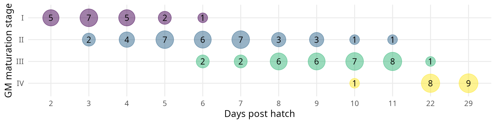

# A reproducible workflow for identifying and predicting broiler gut microbiota developmental stages using Dirichlet Multinomial Mixture (DMM) modelling.

This repository provides example code to identify gut microbiota (GM) developmental stages in broiler chickens and to predict the developmental stage of new caecal samples.

The workflow applies the Dirichlet Multinomial Mixture (DMM) modelling framework described by Holmes *et al.* (2012) to broiler gut microbiota data. The application to identify GM developmental stages is based on the approach described in Cleiren *et al.* ([preprint](https://doi.org/10.21203/rs.3.rs-11229652/v1)).

**References**

- Holmes I, Harris K, Quince C. (2012). Dirichlet multinomial mixtures: generative models for microbial metagenomics. *PLoS ONE*, 7(2), e30126. https://doi.org/10.1371/journal.pone.0030126
- Cleiren *et al.* (2026).Decoding early-life gut microbiota: discrete and reproducible maturation stages in broiler chickens (https://doi.org/10.21203/rs.3.rs-11229652/v1).

## Data

Two longitudinal datasets of the caecal microbiota (16S rRNA gene amplicon sequencing) are included.

**Reference dataset**

The reference dataset contains caecal 16S rRNA gene amplicon sequencing data from Ross 308 broilers sampled between 2 and 29 days post-hatch. This is the main dataset used by Cleiren *et al.* to identify GM developmental stages.

**Early feeding dataset**

The early feeding dataset contains caecal 16S rRNA gene amplicon sequencing data from two broiler breeds: Ross 308 and Hubbard Redbro. Two feeding groups are included: 

- **Early fed (EF):** immediate access to feed and water after hatch.
- **Delayed fed (DF):** 48-hour feed and water deprivation after hatch. 

The datasets are provided as:

- **Metadata:** sample information, including bird age, breed and treatment group.
- **ASV abundance table:** read counts per ASV after preprocessing.
- **Taxonomy table:** taxonomic classification of each ASV.
- **Representative sequences:** nucleotide sequences of the ASVs

## Scripts

The code is written in R Markdown. Don't forget to change the working directory before you start.

Two different scripts are given:
1. **01_reference_DMM.Rmd**: Code to perform DMM modeling on a new dataset. Here we use the reference dataset as an example
2. **02_AddSamplesToRef_DMM.Rmd**: Two methods to add new samples to a reference dataset are shown. 
    1. Add new samples to an existing dataset and rerun the DMM model. This method was used in the manuscript.
    2. Use a previously trained model and predict the GM maturation stage of the new samples.

## Results

Example output is shown in the results folder.

Graphic representation of the microbiota development over time. Nodes are ordered based on age of the birds and labelled to include the number of samples per timepoint allocated to each GM maturation stage. 
